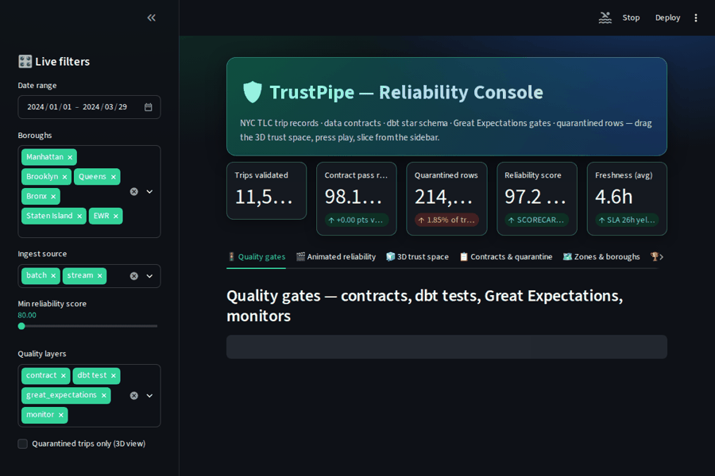

# TrustPipe — A Reliability-First Data Platform for NYC Trip Records

> Most data engineering projects prove you can *move* data. This one proves the data is *correct* — with contracts, anomaly detection, and CI gates that fail the build when reliability breaks.

TrustPipe is an end-to-end ELT platform built on the NYC TLC trip record dataset (hundreds of millions of rows across yellow, green, and FHV files). It ingests batch, API, and streaming sources into a dimensionally modeled warehouse — but its headline is the **data-reliability layer** wrapped around every stage: data contracts at ingest, automated quality suites, statistical anomaly detection, freshness/volume/schema-drift monitoring, and a published reliability scorecard.

Built by an engineer with a QA/SDET background, TrustPipe treats data quality as the product rather than a bolt-on.



## The console

TrustPipe's serving layer is an interactive reliability console (`app/dashboard.py`, Streamlit + Plotly) that runs standalone on deterministic demo data shaped from `config/contracts.yml`, the dbt star schema and the quality suites in this repo — no warehouse connection required:

- **Live sidebar filters** — date range, boroughs, ingest source (batch / stream), minimum reliability score and quality layers; every chart, table and KPI re-renders instantly.
- **KPI cards with deltas** — trips validated vs. the prior equal-length period, contract pass rate, quarantined rows, reliability score and freshness against the 26h / 1h SLAs.
- **Quality gates** — contract, dbt test, Great Expectations and monitor checks in one view, with failure counts and the pass-rate dips that mark the volume, fare and drift incidents.
- **Animated charts** — Plotly `animation_frame` views: daily trips by borough and a cumulative quarantined-rows race you can play.
- **3D trust space** — a rotatable `Scatter3d` of sampled trips in distance × fare × duration space (quarantined rows stand apart), plus a borough × date reliability **surface terrain** (drag to orbit, scroll to zoom).
- **Contracts & quarantine** — the declared rules for `yellow_trips`, `weather` and `ride_stream`, the quarantined sample that a violation blocks from RAW, and the fare distribution behind it.
- **Zones, boroughs & scorecard** — borough rollups from `dim_zone` / `fact_trips` and the published reliability scorecard (contracts 35%, dbt gates 25%, runtime quality 25%, automation 15%).
- **Dark UI** — gradient hero header, glass KPI cards and a custom dark theme (`.streamlit/config.toml` + inline CSS).

Run it with: `streamlit run app/dashboard.py`

---

## Why This Project Exists

The typical portfolio pipeline lands raw data, models a star schema, and stops. When something silently breaks — a vendor changes a column type, trip volumes drop 40% overnight, a fare field goes null — nobody knows until a dashboard looks wrong three days later.

TrustPipe is designed around a different question: **how do you *prove* a multi-terabyte warehouse is trustworthy, continuously, without a human staring at it?** Every architectural decision here optimizes for that.

---

## Architecture

```
                        ┌─────────────────────────────────────────────┐
                        │              SOURCES                          │
                        │  TLC parquet (batch)   NOAA weather (API)     │
                        │       Kafka synthetic ride stream             │
                        └───────────────┬─────────────────────────────┘
                                        │
                          ┌─────────────▼──────────────┐
                          │   INGEST + DATA CONTRACTS   │
                          │  Python loaders · schema     │
                          │  validation · contract gate  │
                          └─────────────┬──────────────┘
                                        │
                          ┌─────────────▼──────────────┐
                          │      WAREHOUSE (RAW)        │
                          │   Snowflake / BigQuery       │
                          └─────────────┬──────────────┘
                                        │
                          ┌─────────────▼──────────────┐
                          │      dbt TRANSFORMATIONS     │
                          │  staging → intermediate →    │
                          │  marts (star schema)         │
                          └─────────────┬──────────────┘
                                        │
              ┌─────────────────────────┼─────────────────────────┐
              │                         │                          │
     ┌────────▼────────┐     ┌──────────▼─────────┐     ┌─────────▼────────┐
     │  RELIABILITY     │     │   ANALYTICS         │     │   COST / PERF    │
     │  dbt tests +     │     │   fact_trips        │     │  partition +     │
     │  Great Expect.   │     │   dim_zone          │     │  cluster tuning  │
     │  anomaly detect  │     │   dim_datetime      │     │  query timings   │
     │  drift monitor   │     │   dim_vendor        │     │  warehouse cost  │
     │  scorecard       │     │                     │     │  before/after    │
     └──────────────────┘     └─────────────────────┘     └──────────────────┘

        Orchestration: Apache Airflow (or Dagster asset graph)
        Infra: Terraform · Docker · Kubernetes manifest
        CI: GitHub Actions — contract + test gates block merge
```

---

## Data Model

A conformed star schema built from the TLC taxi-zone lookup as the shared dimension.

| Table | Grain | Notes |
|-------|-------|-------|
| `fact_trips` | one row per trip | fare, distance, duration, tip, passenger count, surcharge fields |
| `dim_zone` | one row per taxi zone | conformed dimension from TLC zone lookup |
| `dim_datetime` | one row per hour | supports time-of-day / seasonality analysis |
| `dim_vendor` | one row per vendor | ride source / provider |
| `dim_weather` | one row per zone-hour | NOAA enrichment; also feeds anomaly signals |

---

## The Reliability Layer (the differentiator)

This is where TrustPipe spends its complexity budget.

- **Data contracts at ingest.** Every source declares an expected schema and value constraints. A contract violation blocks the load rather than poisoning downstream tables.
- **dbt tests + Great Expectations.** Not-null, uniqueness, referential integrity, accepted-range, and custom business-rule suites on critical columns.
- **Statistical anomaly detection.** Isolation Forest + ARIMA baselines flag abnormal trip volumes and fare distributions per zone/hour, catching silent drift that schema checks miss.
- **Freshness, volume, and schema-drift monitors.** Alerts when a table stops updating, row counts deviate from expected bands, or a column's type/shape changes.
- **CI gates.** GitHub Actions runs the contract + test suites on every PR. Reliability failures fail the build — you cannot merge a pipeline change that breaks a data guarantee.
- **Reliability scorecard.** A published summary of test coverage, freshness SLAs, and open data-quality issues, so trust is measurable rather than assumed.

---

## Ingestion Paths

| Path | Source | Mechanism |
|------|--------|-----------|
| Batch | TLC historical parquet | Python loaders, partitioned bulk load |
| API | NOAA weather | scheduled pull, joined for enrichment + anomaly context |
| Streaming | synthetic live ride events | Kafka producer → micro-batch merge into `fact_trips` |

The streaming path demonstrates Kafka ingest merging into the same fact table the batch path populates, without double-counting.

---

## Cost & Performance Work

TLC's scale makes this real rather than decorative:

- Partitioning and clustering strategy on `fact_trips`, with documented before/after query timings.
- Warehouse cost comparison across configurations.
- Indexing / pruning analysis on the heaviest analytical queries.

Numbers are recorded in [`docs/performance.md`](docs/performance.md) rather than claimed in the abstract.

---

## Tech Stack

**Core:** Python · SQL · dbt · Snowflake *(or BigQuery)*
**Orchestration:** Apache Airflow *(Dagster variant available)*
**Streaming:** Kafka
**Quality:** Great Expectations · dbt tests · custom anomaly detectors (Isolation Forest, ARIMA)
**Infra:** Terraform · Docker · Kubernetes
**CI:** GitHub Actions

---

## Repository Structure

```
trustpipe/
├── ingest/              # batch, API, and streaming loaders + contract checks
├── dbt/                 # staging, intermediate, marts + tests
├── quality/             # Great Expectations suites, anomaly detectors, monitors
├── orchestration/       # Airflow DAGs (or Dagster assets)
├── infra/               # Terraform, Dockerfile, k8s manifests
├── scorecard/           # reliability scorecard generator + output
├── docs/
│   ├── architecture.md
│   ├── performance.md
│   └── gaps.md          # honest limitations — see below
└── .github/workflows/   # CI: contract + test gates
```

---

## Getting Started

```bash
# 1. Clone
git clone https://github.com/sajansshergill/trustpipe.git
cd trustpipe

# 2. Provision infra (warehouse, storage, roles)
cd infra && terraform init && terraform apply

# 3. Configure connection
cp .env.example .env   # add warehouse credentials

# 4. Run the pipeline
docker compose up       # or trigger the Airflow DAG

# 5. Run the reliability suite
make quality            # dbt tests + Great Expectations + anomaly checks
```

Detailed setup lives in [`docs/architecture.md`](docs/architecture.md).

---

## Honest Gaps & Limitations

*(Kept deliberately visible — reliability engineering means naming what isn't guaranteed.)*

- The streaming path uses a **synthetic** ride generator, not a live production feed; it demonstrates the merge pattern, not real-world event volume.
- Kubernetes deployment is validated on a local cluster (kind/minikube), not a managed cloud cluster.
- Anomaly-detection thresholds are tuned on historical TLC distributions and would need recalibration for a different domain.
- Cost figures reflect a single warehouse tier and region; absolute numbers vary by account configuration.

See [`docs/gaps.md`](docs/gaps.md) for the full list.

---

## What This Demonstrates

- Scalable ELT across batch, API, and streaming sources
- Dimensional modeling with dbt on a genuinely large dataset
- Production-style data quality: contracts, tests, anomaly detection, drift monitoring
- Query/cost optimization on multi-terabyte data with documented results
- Infrastructure-as-code and containerized workloads
- CI that enforces data guarantees, not just code correctness

---

**Author:** Sajan Shergill · [LinkedIn](https://linkedin.com/in/sajanshergill) · [Portfolio](https://sajansshergill.github.io) · sajansshergill@gmail.com
